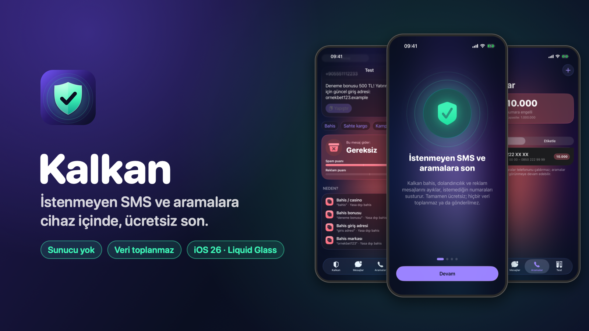
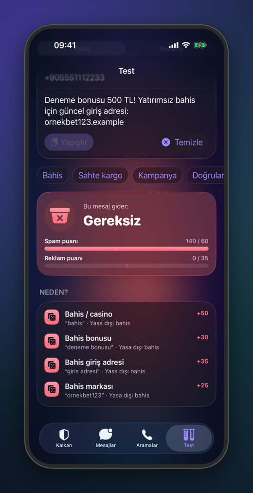
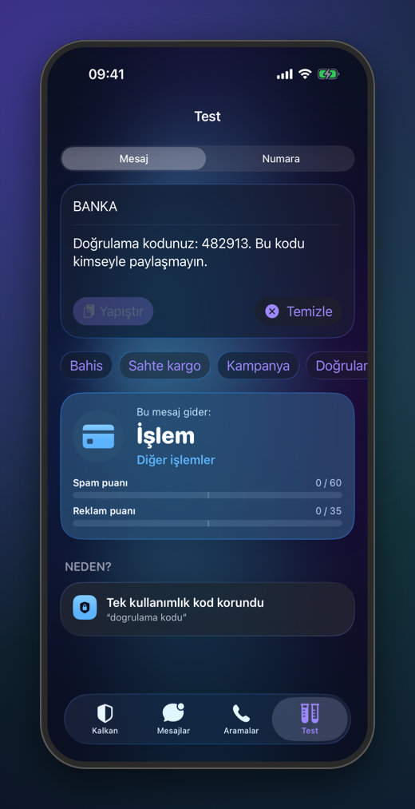
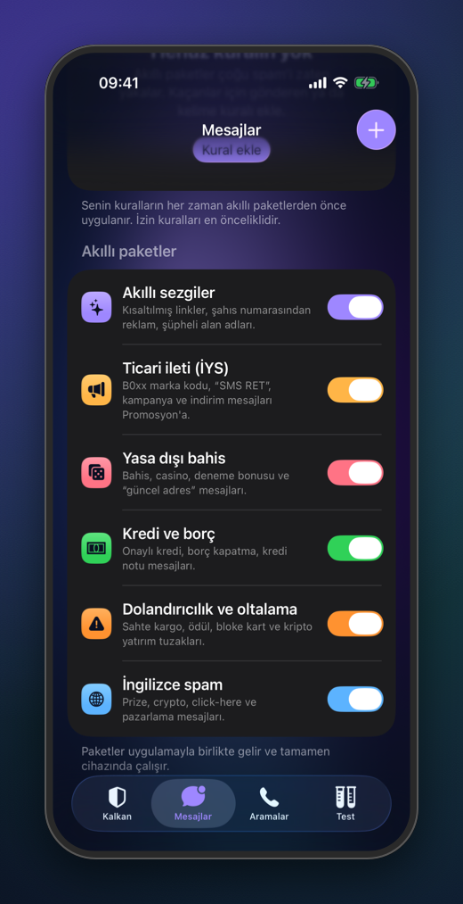
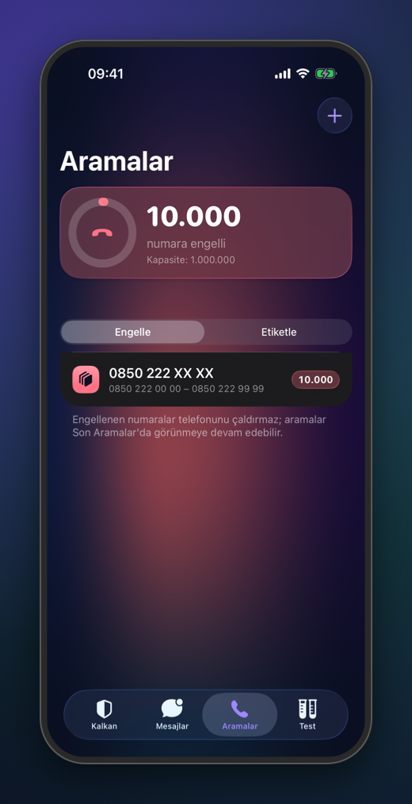
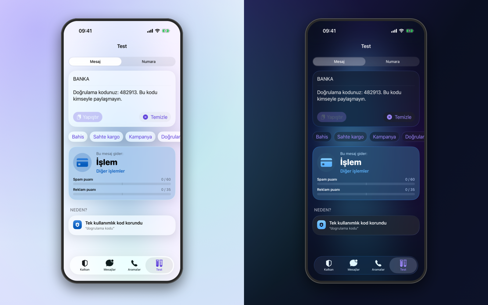
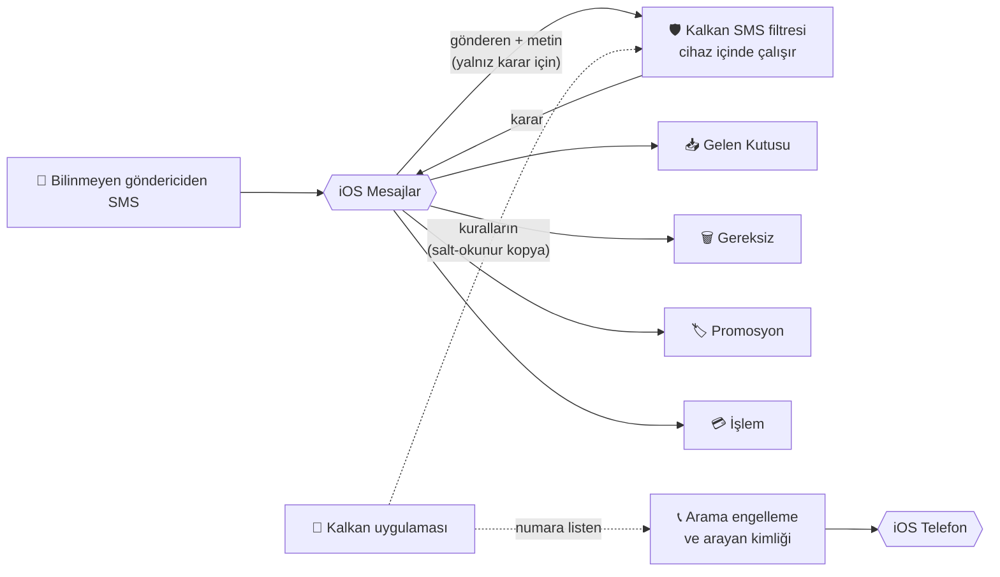
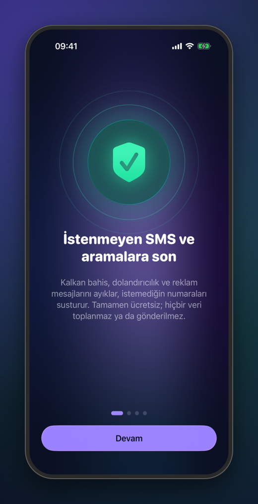
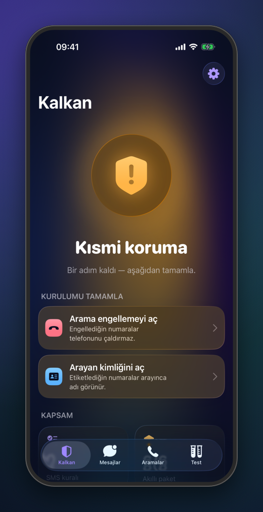
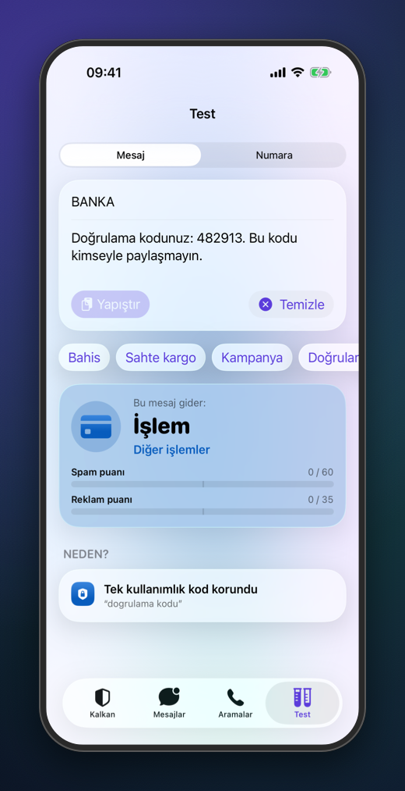

  

<h3 align="center">Spam'i susturan, seni dinlemeyen kalkan.</h3>

  Kalkan; bahis, dolandırıcılık ve reklam mesajlarını iPhone'unun içinde ayıklar, 
  istemediğin numaraları susturur. <b>Sunucu yok. Hesap yok. Veri toplanmaz.</b>

  
  
  

  <a href="https://mhmtmutlu.github.io/kalkan-app/privacy.html">Gizlilik Politikası</a> ·
  <a href="https://mhmtmutlu.github.io/kalkan-app/support.html">Destek</a> ·
  <a href="mailto:apps.support.mm@gmail.com">İletişim</a>

 

<table align="center">
  <tr>
    <td align="center" width="160"><h2>0</h2>sunucu, hesap, analitik</td>
    <td align="center" width="160"><h2>6</h2>akıllı kural paketi</td>
    <td align="center" width="160"><h2>4</h2>klasör: Gelen, Gereksiz, Promosyon, İşlem</td>
    <td align="center" width="160"><h2>1M</h2>numaraya kadar engelleme kapasitesi</td>
    <td align="center" width="160"><h2>TR · EN</h2>tam yerelleştirilmiş arayüz</td>
  </tr>
</table>

 

## Her kararın bir nedeni var

<table>
  <tr>
    <td width="44%" align="center"></td>
    <td>
      <h3>Kara kutu yok.</h3>
      
Bir mesajı <b>Test</b> ekranına yapıştır: Kalkan nereye gideceğini söyler ve her puanın nereden geldiğini gösterir — “bahis” kelimesi <b>+50</b>, “deneme bonusu” <b>+30</b>, giriş adresi <b>+35</b>…

      
Test ekranı, iPhone'un SMS filtresinde çalışan <b>motorun ta kendisini</b> kullanır. Burada gördüğün sonuç, gerçekte olacak sonuçtur.

      
İpucu: <code>k@zand1n1z</code>, <code>b e d a v a</code>, görünmez karakterler… Türkçe karakter ve hile denemeleri normalleştirilerek yakalanır.

    </td>
  </tr>
</table>

## Önemli mesajın kaybolmaz

<table>
  <tr>
    <td>
      <h3>Kodun Gereksiz'e düşmez.</h3>
      
Doğrulama kodları, banka harcama bildirimleri, kargo ve randevu mesajları <b>İşlem</b> klasörüne ayrılır; iOS'un Finans, Siparişler, Sağlık gibi alt kategorileriyle düzenlenir.

      
Bir mesaj spam kelimeleri içerse bile tek kullanımlık kod <b>korunur</b> — ta ki içinde kısaltılmış bir “tıkla” linki olana kadar. Oltalama, kod kılığına giremez.

    </td>
    <td width="44%" align="center"></td>
  </tr>
</table>

## Türkiye'nin spam'ini tanır

<table>
  <tr>
    <td width="44%" align="center"></td>
    <td>
      <h3>Hazır, açıp kapatılabilir paketler.</h3>
      <table>
        <tr><td>✨</td><td><b>Akıllı sezgiler</b> — kısaltılmış linkler, şahıs numarasından reklam, şüpheli alan adları</td></tr>
        <tr><td>📣</td><td><b>Ticari ileti (İYS)</b> — <code>B0xx</code> marka kodu, “SMS RET”, kampanyalar → Promosyon</td></tr>
        <tr><td>🎲</td><td><b>Yasa dışı bahis</b> — deneme bonusu, “güncel giriş adresi”</td></tr>
        <tr><td>💸</td><td><b>Kredi ve borç</b> — onaylı kredi, borç kapatma, kredi notu</td></tr>
        <tr><td>⚠️</td><td><b>Dolandırıcılık</b> — sahte kargo, ödül, bloke kart, kripto vaatleri</td></tr>
        <tr><td>🌍</td><td><b>İngilizce spam</b> — prize, crypto, click-here</td></tr>
      </table>
      
Yetmezse kendi kuralını yaz: gönderen, kelime, önek ya da <b>regex</b> — canlı önizlemeyle.

    </td>
  </tr>
</table>

## Aramalarda son söz senin

<table>
  <tr>
    <td>
      <h3>Tek numara da olur, bütün bir blok da.</h3>
      
<code>0532 123 45 67</code> gibi tek bir numarayı ya da <code>0850 222 XX XX</code> gibi <b>10.000 numaralık</b> bir aralığı tek satırda engelle. Panodan toplu ekle.

      
Numaralara kendi etiketini ver; aradıklarında ekranda “Tele-satış” yazsın, telefon yine çalsın.

      
Kapasite halkası, iPhone'un kaldırabileceği <b>1.000.000</b> numaralık sınıra ne kadar yaklaştığını gösterir — Kalkan bu sınırı aşmana izin vermez.

    </td>
    <td width="44%" align="center"></td>
  </tr>
</table>

## Gece de gündüz de güzel

  

  iOS 26'nın <b>Liquid Glass</b> tasarım dili, nefes alan renk geçişleri ve her iki modda da <b>WCAG AA</b> kontrastlı renk paleti. 
  Büyük yazı boyutlarında düzen kendini yeniden kurar; VoiceOver ekranları okur; Hareketi Azalt açıksa animasyonlar durur.

## Nasıl çalışır?

Mesaj Kalkan'a iOS tarafından yalnızca karar vermek için gösterilir. Filtre uzantısı internete çıkamaz ve hiçbir şey kaydedemez — bu bir söz değil, iOS'un kuralıdır.

## Gizlilik, tasarımın ta kendisi

<table>
  <tr>
    <td align="center" width="25%">🔒 <b>Cihazda kalır</b> Sınıflandırma iPhone'da yapılır; mesajlar hiçbir yere gönderilmez.</td>
    <td align="center" width="25%">🚫 <b>Ağ yok</b> Uygulamanın internet kullanan tek bir özelliği yok.</td>
    <td align="center" width="25%">👤 <b>Hesap yok</b> Kayıt, giriş, reklam, analitik ya da izleme yok.</td>
    <td align="center" width="25%">🧹 <b>Tek dokunuşla sil</b> “Her şeyi sıfırla” tüm kuralları ve listeleri kaldırır.</td>
  </tr>
</table>

App Store gizlilik etiketi: <b>Veri Toplanmaz</b> · <a href="https://mhmtmutlu.github.io/kalkan-app/privacy.html">Gizlilik politikasının tamamı</a>

## Teknik bakış

<table>
  <tr><td><b>Platform</b></td><td>iOS 26+, iPhone · Swift 6 · SwiftUI · Liquid Glass</td></tr>
  <tr><td><b>SMS filtresi</b></td><td><code>IdentityLookup</code> Message Filter Extension · iOS 16+ işlem/promosyon alt kategorileri</td></tr>
  <tr><td><b>Aramalar</b></td><td>İki <code>CallKit</code> Call Directory uzantısı (engelleme + kimlik) · bellek dostu, parça parça yükleme</td></tr>
  <tr><td><b>Mimari</b></td><td>Arayüzden bağımsız, testli <code>KalkanKit</code> paketi (Core · Phone · Store) · uygulama ve uzantılar aynı motoru paylaşır</td></tr>
  <tr><td><b>Veri</b></td><td>App Group içinde atomik JSON · uzantılar salt-okunur · ilk kilit açılışından sonra kilitliyken de okunabilir</td></tr>
  <tr><td><b>Gizlilik</b></td><td>Her hedefte <code>PrivacyInfo.xcprivacy</code> · üçüncü taraf SDK yok · ağ erişimi yok</td></tr>
  <tr><td><b>Erişilebilirlik</b></td><td>Dynamic Type · VoiceOver · Hareketi Azalt · WCAG AA renk paleti</td></tr>
  <tr><td><b>Kalite</b></td><td>40+ otomatik test · uyarısız Release derlemesi · yayın öncesi otomatik kontrol listesi</td></tr>
</table>

<b>Karar motoru nasıl düşünür?</b>

 

Her mesaj aynı sırayla değerlendirilir; ilk kesin karar kazanır:

1. **İzin kuralların** — güvendiğin gönderen ya da kelime her zaman Gelen Kutusu'na.
2. **Kendi kuralların** — Gereksiz › Promosyon › İşlem önceliğiyle.
3. **Tek kullanımlık kod koruması** — doğrulama kodu varsa ve kısaltılmış link yoksa → İşlem.
4. **Paket puanları** — her sinyal ağırlıklı puan ekler; spam ve reklam puanları hassasiyet eşiğiyle karşılaştırılır
   (*Hafif* 80/50 · *Dengeli* 60/35 · *Sıkı* 35/20).
5. **İşlem mesajı** — banka, kargo, sağlık, operatör, kamu hizmeti kalıpları.
6. Hiçbiri değilse → **Gelen Kutusu**.

**Saldırı modu** ve **sessiz saatler**, belirlenen süre boyunca eşikleri “Sıkı”ya çeker. Saldırı modu süresi bitince kendiliğinden kapanır.

<b>Metin nasıl normalleştirilir?</b>

 

| Girdi | Normalleştirilmiş | Neden |
| --- | --- | --- |
| `KAZANDINIZ` / `kazandınız` | `kazandiniz` | Türkçe büyük-küçük harf (`İ/ı`) ve harf katlama |
| `k@zand1n1z` | `kazandiniz` | Harf yerine kullanılan rakam ve simgeler |
| `b e d a v a` | `bedava` | Araya boşluk ya da nokta sıkıştırma |
| görünmez karakterli `bahis` | `bahis` | Sıfır genişlikli karakterler temizlenir |
| `sohbet` | — | Kelime sınırları sayesinde “bet” sanılmaz |

<b>Numara aralıkları nasıl çalışır?</b>

 

iOS arama engellemede joker karakter desteklemez; Kalkan önekleri numara aralığına çevirir ve iOS'a sıralı, tekrarsız
bir akış olarak verir:

| Yazdığın | Kapsadığı | Numara |
| --- | --- | --- |
| `0532 123 45 67` | tek numara | 1 |
| `0850 222 XX XX` | 0850 222 00 00 – 0850 222 99 99 | 10.000 |
| `0212 444 1*` | 0212 444 10 00 – 0212 444 19 99 | 1.000 |

`0850`, `+90 850` ve `90850` aynı kabul edilir. Örtüşen aralıklar birleştirilir; tek numaraya verdiğin etiket, onu kapsayan aralığın etiketinden önceliklidir.

 

  
  
  

  <b>Kalkan</b> · iPhone için ücretsiz SMS ve arama filtresi 
  <a href="https://mhmtmutlu.github.io/kalkan-app/privacy.html">Gizlilik</a> ·
  <a href="https://mhmtmutlu.github.io/kalkan-app/support.html">Destek</a> ·
  <a href="mailto:apps.support.mm@gmail.com">apps.support.mm@gmail.com</a> 
  © 2026 Mehmet Mutlu. Tüm hakları saklıdır. iPhone ve iOS, Apple Inc.'in ticari markalarıdır.

